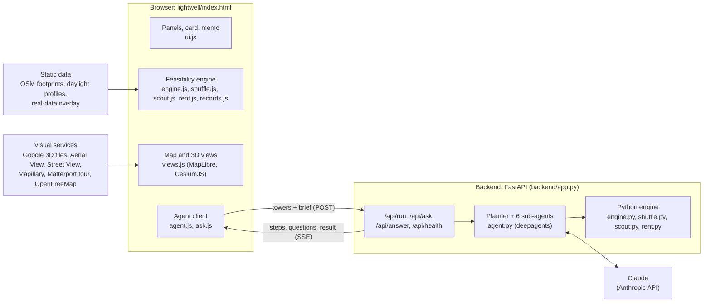
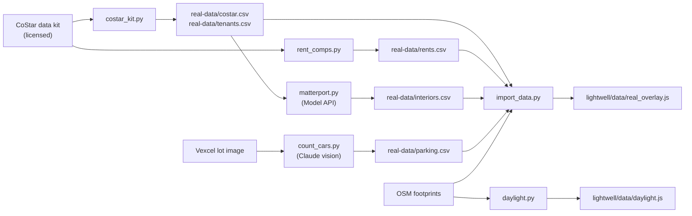

# Lightwell: project documentation

Lightwell finds the empty office towers in downtown Houston that could become homes, shows why, and plans what it
would take. This document explains what it does, how it works inside, where every number comes from, and how to run
and extend it. For a short introduction and the quick start, read the [README](../README.md) first.

Built for HackPrinceton Fall 2026 (13–15 November 2026). Every number in this document comes from the code on `main`.

## Contents

1. [Overview](#1-overview)
2. [A run from start to finish](#2-a-run-from-start-to-finish)
3. [Architecture](#3-architecture)
4. [Data: sources, tags and modes](#4-data-sources-tags-and-modes)
5. [The feasibility engine](#5-the-feasibility-engine)
6. [Policy, deals and checks](#6-policy-deals-and-checks)
7. [The AI agent](#7-the-ai-agent)
8. [Backend API](#8-backend-api)
9. [Using the interface](#9-using-the-interface)
10. [Setup and operation](#10-setup-and-operation)
11. [Real-data pipeline](#11-real-data-pipeline)
12. [Testing](#12-testing)
13. [Security, privacy and licensed data](#13-security-privacy-and-licensed-data)
14. [Limits and honesty rules](#14-limits-and-honesty-rules)
15. [Extending Lightwell](#15-extending-lightwell)
16. [File reference](#16-file-reference)
17. [Glossary](#17-glossary)
18. [Team and credits](#18-team-and-credits)

---

## 1. Overview

### The problem
About a quarter of downtown Houston's office space is empty, and the city needs homes. Most office towers cannot simply
become apartments: their floors are too deep, so the middle of a floor is 60–120 ft from a window, and a bedroom needs
one. Tenants are scattered across floors on long leases. And since 1 September 2025, Texas SB 840 and SB 2477 let an
office building become homes without rezoning, but only if at least 65% of it becomes residential.

### What Lightwell does
You describe what you want in plain English (*"offices I can turn into homes for under $300k a home"*). A team of AI
agents then screens every downtown tower:

- tests every floor for daylight, and against the real neighbouring buildings;
- tries cutting a courtyard (a *lightwell*) through deep floors;
- prices the conversion and the carbon it saves;
- runs a preliminary fire screen and the Texas 65% check;
- plans the tenant moves that would unlock a tower, and lets a red-team agent attack that plan;
- checks the rents a conversion needs against real asking rents nearby;
- cross-checks the records about each tower and flags where they disagree;
- stops to ask you for the one measurement that would change its recommendation;
- drafts an owner memo for you to approve.

Every number on screen carries a tag saying where it came from (CoStar, Matterport, OpenStreetMap, an estimate, an
assumption, or you), and one click shows the evidence behind it.

### Who it is for
Building owners, brokers, lenders and city housing staff who need to know which empty tower is worth a closer look
first.

### What it is not
Lightwell is a **screening tool**. It says where to look first. It is not a design, a code review, a daylight study, a
valuation or legal advice. An architect, a fire engineer, a cost consultant and a lawyer make the final call.

---

## 2. A run from start to finish

1. **You ask.** The request is parsed into a **brief**: cost cap per home, minimum homes, maximum distance from a
   window, whether lightwells are allowed, whether parking evidence counts, which real data is required, and the
   daylight rules.
2. **The planner reads the brief** and hands work to six sub-agents. The steps stream live into the Agent tab, and the
   team strip lights up whichever sub-agent is working.
3. **Market data.** CoStar records (leasing, year, empty floors, tenants, sprinklers) for each tower; Vexcel parking
   counts when loaded; occupancy discrepancies and the record cross-check.
4. **Data scout.** For towers CoStar does not cover, it estimates percent leased from similar CoStar towers.
5. **Feasibility.** Every tower is laid out floor by floor, scored and ranked; the top towers get the fire screen and
   Daylight X-ray.
6. **Rent and policy.** The rent check for the leaders; the Texas fast-track status for the top five.
7. **Review and replan.** The agent tests a worse value for every estimated input on the shortlist. If one would change
   the decision, it pauses and asks you for that measurement. When you answer, it re-ranks and explains what changed.
   Where a Matterport scan has already measured the ceiling, it says the question is settled and does not ask.
8. **Deals.** For the leading tower it plans the tenant moves that reach the 65% rule and prices them.
9. **Red team.** A sceptical "broker and lender" attacks the move plan. If the plan is weak, the planner tries the next
   tower.
10. **Memo.** The planner drafts the owner memo for its pick. You read it, correct any value, and approve it. The memo
    is marked *not reviewed* again as soon as anything that affects it changes.

A full run with Claude takes about three minutes; the offline agents finish in seconds.

---

## 3. Architecture

### Components



- **The page does the maths too.** The feasibility engine exists twice: `lightwell/js/engine.js` for the page and
  `backend/engine.py` for the agent (likewise `shuffle`, `scout` and `rent`). Tests check that both give identical
  numbers on every tower, so what the agent says always matches what you see.
- **The page sends the towers to the agent.** Each run posts the current towers, with every value and its source tag,
  plus the brief and the assumptions. The agent reasons over exactly what you are looking at, including your
  corrections.
- **Three agent modes, so the demo never breaks:**

| Mode | When | What runs |
|---|---|---|
| Claude through deepagents | backend running and `ANTHROPIC_API_KEY` set | a planner and six sub-agents choose which tools to call |
| Scripted backend | backend running, no key | the same tools in a fixed order |
| In-browser agent | backend not reachable, or it fails mid-run | the same plan, run by `agent.js` in the page |

The badge under *Run agent* always says which one is running.

### Technology

| Part | Technology |
|---|---|
| Page | plain HTML, CSS and JavaScript (no build step); one global `window.LW` |
| Map | MapLibre GL 4.7.1 with the OpenFreeMap dark style |
| 3D city | CesiumJS 1.124; Google Photorealistic 3D Tiles with a Google key (or Cesium ion), otherwise extruded OpenStreetMap buildings |
| Street photos | Mapillary JS 4.1.2 first, Google Street View as fallback |
| Backend | Python 3.10+, FastAPI, Server-Sent Events |
| Agent | LangChain deepagents with Claude (`claude-opus-5-5` by default) |
| Tests | Node (engine in a VM) and pytest |

---

## 4. Data: sources, tags and modes

### Sources

| Source | What it gives | Status |
|---|---|---|
| **OpenStreetMap** | 1,220 building footprints and heights in downtown Houston; 58 qualify as candidate towers on their own | always loaded (public data, committed) |
| **CoStar data kit** | for the downtown office towers it covers: name, class, rating, percent leased, empty floors, year built and renovated, sprinklers, slab-to-slab height, current tenants with floors and lease ends, sale history, Matterport scan ids; asking rents nearby | 15 towers and 401 tenancies; 65 rental listings for the rent check. Licensed: never committed |
| **Matterport** (CoStar's scans) | clear ceiling height, floor area and extent of the scanned office space | 6 of the 15 towers have enough scanned office space; also shown as the in-page 3D tour |
| **Vexcel** | aerial images for counting parked cars | import path and car counter built; no captures loaded yet |
| **Google** | Photorealistic 3D city, Street View, Aerial View flyovers | visual only: never used in a score |
| **You** | corrections and measurements | tagged YOU; remembered in your browser |

With the CoStar data loaded there are 63 candidate towers: a real CoStar office record always qualifies, even when its
OpenStreetMap footprint alone would not.

### Source tags
Every input value carries one tag. The tag is a button: it opens the evidence drawer for that value.

| Tag | Meaning |
|---|---|
| `COSTAR` | from the CoStar data kit |
| `MATTERPORT` | measured from CoStar's Matterport scans |
| `VEXCEL` | counted from Vexcel aerial images |
| `OSM` | from the OpenStreetMap record |
| `ESTIMATE` | calculated by Lightwell from other values (for example floor-to-floor = height ÷ floors) |
| `ASSUMED` | a stated assumption because nothing was measured (for example a central core) |
| `SIMULATED` | demo stand-in from a seeded random generator; only in Demo mode, never next to a real name |
| `MISSING` | no value in any loaded source |
| `YOU` | corrected or measured by you |
| `FEASIBILITY` | a result of Lightwell's own calculation, not an input |

### Data modes

| | Demo fill-in | Real data only |
|---|---|---|
| Towers with real records | real values | real values |
| Other towers | `SIMULATED` values, anonymous ids (HOU-01, HOU-02…) | `MISSING`; the engine states any assumption it makes |
| Real building names | only next to real CoStar data | only next to real CoStar data |

With the real-data overlay loaded the app starts in *Real data only*. A real building name is never shown next to a
simulated number.

---

## 5. The feasibility engine

Code: `lightwell/js/engine.js` and its mirror `backend/engine.py`. Distances are in feet.

### 5.1 Candidate towers
A building is a candidate when its OpenStreetMap height is known and at least 40 m, it is tagged as an office or
commercial building, its footprint is at most 70,000 sq ft, and its plate is at least 55 ft deep. Stadiums, garages,
hotels, churches, apartments and similar are skipped by name. Any building with a real CoStar office record qualifies
regardless.

Each footprint is reduced to its **minimum bounding rectangle**, W × D (W the long side). Footprints that fill less
than 80% of their rectangle are marked *irregular* and their plate is tagged `ESTIMATE`.

### 5.2 Floor-plate layout
For each typical floor (`layout()`):

1. **Core.** A measured core is used when available; otherwise a central core is assumed, 26% of the width (at least
   40 ft) by 20% of the depth (at least 30 ft), tagged `ASSUMED`.
2. **Homes along the windows.** Each wall gets a strip of homes `u` deep, the brief's maximum distance from a window
   (25–40 ft, default 30). Home widths follow a 22 / 30 / 36 / 30 ft pattern, stretched to fill the wall.
3. **Corridor.** Homes are cut back to leave a 5 ft corridor at the core; a home under 14 ft deep or 300 sq ft is
   dropped.
4. **Home types** by floor area: under 700 sq ft a studio, under 980 sq ft a 1-bed, otherwise a 2-bed.
5. Homes, cores and the courtyard never overlap (checked on every tower), and areas use the true union of rectangles.

Homes count on every floor except the ground floor (lobby).

### 5.3 Lightwell (the courtyard)
A lightwell cuts a courtyard through the middle of the floor so the dark core can hold homes too.

- The courtyard starts `2u + 6` ft in from each edge and must be at least 30 ft across both ways.
- Homes line all four sides of the courtyard, and two new stair cores are assumed at its opposite corners.
- When the brief allows lightwells, the engine keeps whichever version (with or without) costs less per home.
  *Cut a lightwell* on the floor plate forces it.

### 5.4 Daylight
**The window-distance test.** A home counts as daylit because it sits within `u` ft of a window.

**Daylight X-ray** adds the neighbours. `backend/daylight.py` precomputes, for every wall of every tower, how much sky
the wall sees at each height:

- it samples points every 20 ft along the wall and casts a fan of 7 rays over 120°, up to 300 ft;
- along each ray it finds every neighbouring footprint and its height;
- for every 10 ft of height it stores the median, over all rays, of the worst obstruction angle.

The engine then checks every home on every floor. Eye height is 6.5 ft above that floor. A home **sees the sky** when
the obstruction angle in front of its window is at most the brief's limit (default 25°, adjustable 20–35°, after UK
BRE daylight guidance). Homes facing a lightwell are checked against the tower's own height across the courtyard.

- **Score mode** (default): homes that do not see the sky still count as homes but not as daylit, lowering the score.
- **Strict mode**: they do not count at all.
- **Off**: every number equals the plain window-distance test (checked by a test).

### 5.5 Height
Homes need room for ceilings and ducts.

| Evidence | Comfortable | Fails |
|---|---|---|
| Floor-to-floor height (estimate = height ÷ floors; or CoStar's slab-to-slab when it agrees with the building's height within 2.5 ft a storey) | 12.5 ft or more | under 10.5 ft |
| Clear ceiling measured in Matterport scans of office space (used instead whenever it exists) | 8.5 ft or more | under 7.5 ft |

A scanned ceiling also bounds the floor-to-floor height from below: the slab above is at least 1.5 ft higher, so
floor-to-floor is at least ceiling + 1.5 ft.

### 5.6 Preliminary fire screen
An estimate from the plate and the core rectangle, never a code review.

- **Travel distance**: for each home, the walk from its centre to the nearest core (along the grid) plus 10 ft; the
  worst home counts. Limit 250 ft (editable).
- **Stair separation**: the distance between the two stair cores (or the diagonal of a single core), compared with a
  third of the plate's diagonal.
- **Sprinklers**: CoStar's record when there is one; otherwise towers built before 1975 (or of unknown age) are assumed
  to need a full retrofit.

| Status | Rule | Label |
|---|---|---|
| `fail` | travel over 1.2 × the limit (300 ft) | Likely blocker |
| `check` | travel over the limit, or stairs too close | Design work likely |
| `verify` | neither | No blocker found, needs verification |

It always lists what it assumed (stair positions) and what was measured.

### 5.7 Cost and carbon
- Gross floor area = (plate − courtyard) × (floors − 1).
- **Cost** = area × $255/sq ft
  + $20/sq ft abatement if built before 1980
  + $420 per sq ft of courtyard cut, on every floor, when there is a lightwell
  + $9/sq ft sprinkler retrofit when the fire screen says so.
- **Cost per home** = cost ÷ homes. A new-build home costs about $400k for comparison.
- **Carbon avoided** (tonnes CO₂e) = area × 0.0929 m²/sq ft × 500 kg/m² × 60% ÷ 1000: the embodied carbon of a new
  building, of which reuse avoids an assumed 60%.

### 5.8 Vacancy signal
| Evidence | Vacancy |
|---|---|
| Leasing and parking | 1 − (35% × leased + 65% × average parking occupancy) |
| Leasing only | 1 − leased |
| Parking only | 1 − average parking occupancy |
| Neither | 25% (Houston average), stated as an assumption |

### 5.9 Score (0–100)

| Part | Weight | How it is scored |
|---|---|---|
| Daylight | 30% | share of the usable floor that is homes seeing the sky |
| Vacancy | 26% | the vacancy signal above |
| Cost | 20% | full marks at 60% of the cost cap or less, zero at 140% or more |
| Height | 6% | 1 when comfortable (5.5), otherwise 0.4 |
| Age | 8% | built 1960–1995: 1; before 1960, 1996–2008 or unknown: 0.6; after 2008: 0.25 |
| Fire screen | 10% | verify 1, check 0.5, fail 0 |

### 5.10 Passing the brief
A tower passes when **all** of these hold. Otherwise the card lists each reason.

- cost per home is within the cap;
- it has at least the minimum number of homes;
- the fire screen is not a likely blocker;
- the height test does not fail;
- it has every real data layer the brief requires;
- CoStar does not record it as already converted.

### 5.11 Occupancy discrepancy
A tower is flagged when it has at least two parking captures and its reported percent leased is 45 points or more above
the fullest capture. It is an observation to investigate, never an accusation.

### 5.12 Assumptions
All editable live under *Brief → Assumptions*; every tower re-scores at once.

| Assumption | Default |
|---|---|
| Conversion cost | $255 / sq ft |
| Asbestos abatement (built before 1980) | $20 / sq ft |
| Lightwell cut | $420 / sq ft removed |
| Sprinkler retrofit | $9 / sq ft |
| New-build cost per home | $400,000 |
| New-build carbon | 500 kg CO₂e / m² |
| Carbon avoided by reuse | 60% |
| Max travel to a stair | 250 ft |
| Comfortable / lowest floor-to-floor | 12.5 / 10.5 ft |
| Comfortable / lowest measured ceiling | 8.5 / 7.5 ft |
| Least structure above a ceiling | 1.5 ft |
| Vacancy with no evidence | 25% |
| Year built when unknown (for costs) | 1970 |
| Tenant move allowance | $15 / sq ft |
| Early lease exit | $30 / sq ft per year left |
| Lease end not on record | 3 years left |
| Rent check: target yield on cost | 6.5% |
| Rent check: operating cost per home | $7,000 / year |
| Rent check: vacancy | 5% |
| Rent check: rent as a share of income | 30% |
| Houston median household income | $62,900 |

---

## 6. Policy, deals and checks

### 6.1 Texas fast-track (SB 840 / SB 2477)
Code: `shuffle.js` / `shuffle.py`. A screen, not legal advice.

- Floors needed = 65% of the floors, rounded up. Floors free = empty floors on record (CoStar).
- **Ready** when enough floors are free and the building is at least 5 years old; **Needs tenant moves** when floors
  are short; **Too new** under 5 years; **Unknown** without floor-by-floor data.

### 6.2 Tenant moves
`planMoves` frees floors in one tower by moving tenants to nearby towers that have room.

1. Tenants whose leases end soonest go first; tenants with no lease end on record go last.
2. A floor shared by several tenants is freed only when every tenant on it moves.
3. Goal *fast* frees just enough floors for the 65% rule; goal *empty* frees them all.
4. Each tenant goes to the nearest tower with enough empty space, preferring towers that do **not** pass the brief
   (they stay offices and fill up instead of blocking their own homes).
5. Cost per tenant = sq ft × ($15 move + $30 per year of lease left); a missing lease end assumes 3 years.
6. The result: moves, tenants that could not be placed, floors freed, homes gained, cost per home gained, and whether
   the tower then reaches the fast-track. The map shows each move as a gold arc.

### 6.3 Red team
`challengePlan` lists the risks in a move plan:

| Level | Risk |
|---|---|
| high | the tower itself fails the brief; it is under 5 years old; a tenant's lease runs 5+ more years; tenants with nowhere to go; the moves still miss 65% |
| medium | year built unknown; lease ends not on record; a move over 800 m; a receiving tower that is itself a conversion candidate |
| low | tenant data is simulated |

Verdict: **weak** with any high risk, **holds with caveats** with any medium risk, otherwise **holds**. On a weak
verdict the planner tries the next tower once, or says what must be true for the plan to work.

### 6.4 Data scout
Code: `scout.js` / `scout.py`. For towers with no CoStar leasing record:

- takes the 5 most similar CoStar towers, weighting each by distance and height similarity:
  `w = 1 / (1 + distance / 400 m) / (1 + |floor difference| / 15)`;
- pulls the weighted average toward the downtown average (74.8% leased, from CBRE's Houston Q4 2025 figure of 25.2%
  vacant) with the weight of one tower;
- gives a range (weighted spread, at least ±8 points) and a confidence: *medium* with 3 or more CoStar towers within
  600 m, otherwise *low*.

Estimates are tagged `ESTIMATE`, show their source towers in the evidence drawer, and still fail a brief that requires
real CoStar data.

**Which towers to ask CoStar about next:** each tower without a CoStar record is re-run at 55% and 95% leased, and at
1965 and 2000 for year built when that is unknown. Towers whose pass/fail flips, whose score swings by 5+ points, or
that pass but lack floor-by-floor data are ranked by how much the answer would change the decision.

### 6.5 Rent check
Code: `rent.js` / `rent.py`. Would anyone pay the rent a converted tower needs?

- **Rent needed** per home per month = (cost per home × 6.5% + $7,000) ÷ (12 × 95%).
- **Market rent**: real CoStar asking rents within 1.2 km of the tower (2.5 km if fewer than 5 listings). For each
  home type: the median rent of listings with that bedroom count (3 or more listings), else the median $/sq ft × the
  home's size, else the median of all listings.
- **Verdict**: *rents cover it* at 100% or more of the rent needed, *nearly cover it* at 90% or more, otherwise *rents
  fall short*. It also shows the cost per home the market rent supports, and the income needed to afford the rent
  (rent at 30% of income) against Houston's median.
- With no CoStar rents loaded it says so. Nothing is simulated.

### 6.6 Record cross-check
Code: `records.js`. Compares independent records about the same tower and lists where two disagree. Each finding names
both sources and both values, so anyone can check it. Findings are observations to investigate.

| Check | Flagged when |
|---|---|
| Floor-to-floor record vs scan | the floor-to-floor on record is lower than the scanned ceiling + 1.5 ft allows |
| Slab-to-slab vs height | CoStar's slab-to-slab height does not fit the building's height and storeys |
| Leased vs tenant list | percent leased is 25+ points above the share the current tenant list covers |
| Sale vs now | occupancy at the last sale is 25+ points above occupancy now |
| Typical floor vs footprint | CoStar's typical floor is over 135% or under 50% of the map footprint |
| Scan vs typical floor | one scanned floor is more than 110% of CoStar's typical floor |
| Storeys vs height | height ÷ storeys is under 9 ft or over 20 ft |
| Occupancy vs parking | the occupancy discrepancy above |
| Ended leases | tenants still listed as current with a lease end in the past |

On the hackathon's CoStar data it finds 15 disagreements across 11 towers. The findings appear on the card, in the evidence
drawer, in the memo and in the agent's Forensics step.

### 6.7 Review and replan
For each of the top three passing towers, the engine tests a plausible worse value for every weak input:

| Input (when estimated, assumed, simulated or missing) | Tested at |
|---|---|
| Floor-to-floor height | 10 ft, or the lowest a scanned ceiling allows |
| Core size | 40% larger |
| Percent leased | 90% |

A gap is *relevant* when the tower would fail the brief or the leader would drop below the runner-up. The agent asks
you for the most relevant one (at most twice a run, waiting up to 5 minutes). *Skip* keeps the estimate and says so in
the memo. Answers are validated: floor-to-floor 7–25 ft, leased 0–100%, core as *width x depth*. When a Matterport
scan already settles the height question, the agent says so instead of asking.

### 6.8 Home designer
Code: `homes.js` and `designer.js`. Click any home on the floor plate for 3–5 concept apartment plans.

- Templates (studio, 1–3 beds, open or entry kitchen, 1–2 baths, den) are fitted to the home's rectangle.
- A plan is never shown if it breaks a rule: a bedroom without a window, a room under its minimum size (bedroom 9.5 ft
  and 95 sq ft, living room 11 ft and 150 sq ft, bath 5 × 7.5 ft, accessible bath 8 × 8 ft), a room you cannot reach,
  or no bath off the hall.
- The rest are scored on living space, light, room sizes, a shared wet wall and plumbing on the corridor side.
- Filter by bedrooms, baths, work nook or accessible bath, or describe it in words. Shift-click 2–3 neighbouring homes
  on the same wall to merge them into one family home.
- It is read-only: the score, review, memo and CSV are unchanged. These are concept plans, not drawings.

---

## 7. The AI agent

Code: `backend/agent.py` (planner, sub-agents, tools), `backend/app.py` (server), `lightwell/js/agent.js` (client and
in-browser agent), `lightwell/js/ask.js` (chat).

### 7.1 The team

| Agent | Job | Tools |
|---|---|---|
| **Planner** | reads the brief, delegates, reviews the evidence, asks you, drafts the memo | list_towers, get_brief, update_brief, rank_towers, review_evidence, request_measurement, draft_owner_memo |
| **market-analyst** | CoStar records, parking counts, occupancy and record checks, rent check | get_market_records, count_parking, find_occupancy_mismatches, check_rents |
| **data-scout** | estimates for towers CoStar does not cover; which towers to request next | estimate_missing_data, rank_data_requests, explain_tower |
| **feasibility-engineer** | floor plates, ranking, conversion test, fire screen, Daylight X-ray | read_floor_plates, rank_towers, test_conversion, check_fire_safety, check_daylight |
| **policy-analyst** | Texas fast-track screen | check_texas_fast_track |
| **deal-maker** | tenants, leases and the move plan | list_tenants, plan_tenant_moves, check_texas_fast_track |
| **red-team** | attacks the move plan and the evidence | challenge_plan, review_evidence, list_tenants |

### 7.2 The planner's plan
1. List the towers. If the request asks for something the brief does not reflect, update the brief first.
2. Market data and occupancy (market-analyst); estimates and data requests (data-scout).
3. Rank, then test conversion, the fire screen and daylight for the top three (feasibility-engineer); rent check for
   the top three passing towers (market-analyst).
4. Texas fast-track for the top five passing towers (policy-analyst).
5. Review the evidence on the top three; ask for the one decision-relevant measurement; re-rank and explain the change.
   Never recommend a tower that fails the brief.
6. Plan tenant moves for the leader if it needs them (deal-maker).
7. Red-team the plan; on a weak verdict, try another tower once or say what must be true.
8. Draft the owner memo for the single best passing tower, with a two-sentence rationale.

### 7.3 Tools
All 25 tools run the same engine as the page and return JSON with source tags.

| Tool | What it does |
|---|---|
| `list_towers` | every candidate tower with id, floors and plate size |
| `get_brief` / `update_brief` | read or change the brief (only the parts the user asked for) |
| `get_market_records` | percent leased and year built, with source tags |
| `count_parking` | parking occupancy per capture date |
| `read_floor_plates` | plate, floor-to-floor, core, and any scanned ceiling height |
| `rank_towers` | screen every tower and return the best, passing first, with reasons |
| `test_conversion` | full result for one tower: homes, mix, cost, daylight, lightwell, carbon |
| `check_fire_safety` | the preliminary fire screen with its assumptions |
| `check_daylight` | Daylight X-ray: homes facing a neighbour, which walls and floors, the main blocker |
| `find_occupancy_mismatches` | occupancy discrepancies and the record cross-check |
| `review_evidence` | the what-if test on every weak input of the shortlist |
| `request_measurement` | pause and ask the user for one value; re-rank with the answer |
| `check_texas_fast_track` | fast-track status, floors needed and free, age |
| `list_tenants` | tenants with floors, area and lease end |
| `plan_tenant_moves` | the move plan (goal *fast* or *empty*) |
| `challenge_plan` | the red-team risks and verdict |
| `draft_owner_memo` | mark the pick and its rationale for the user to approve |
| `estimate_missing_data` | the data scout's estimates |
| `rank_data_requests` | which towers to ask CoStar about next |
| `explain_tower` | everything about one tower, with every source |
| `compare_towers` | 2–4 towers side by side |
| `preview_brief` | what would change under another brief, without changing it |
| `check_rents` | the rent check |
| `answer_user` | the final answer in the chat |

### 7.4 Rules the agent is given
- Values tagged `SIMULATED`, `ESTIMATE`, `ASSUMED` or `MISSING` are not measured; say so when relying on them.
- Occupancy discrepancies are observations to investigate, never accusations.
- The fire screen is preliminary: never call a tower fire-safe.
- The fast-track screen is not legal advice.
- Daylight X-ray is a screening check: never call a tower daylight-compliant.

### 7.5 Ask Lightwell (chat)
Ask about any tower, compare towers, try a what-if (*"what if the cap were $350k?"*, with an *Apply* button), the
fast-track, tenant moves or the data gaps. Tower names in answers link to the map. With a key, Claude answers through a
second deepagent with the same tools (`POST /api/ask`). Without one, the page answers the common questions itself from
the same engine.

### 7.6 Memory between visits
Code: `memory.js`. The brief you settled on and the values you corrected are kept in your browser (`localStorage`,
key `lightwell.memory.v1`) and restored on the next visit. A dot on the Brief tab shows a changed brief; the agent's
first step says what it remembered and it does not ask again for a value you gave. *Forget* clears it. Nothing leaves
your browser.

---

## 8. Backend API

Server: `uvicorn app:app --port 8000` from `backend/`. CORS is open for local use.

### `GET /api/health`
```json
{"ok": true, "llm": true, "model": "claude-opus-5-5"}
```
`llm` is true when an Anthropic key is set.

### `POST /api/run`
Starts a run and streams it back as Server-Sent Events. Body:

```json
{
  "prompt": "Find offices downtown I can turn into homes for under $300k a home.",
  "constraints": {"u": 30, "cap": 300000, "allowLW": true, "minHomes": 20, "useParking": true,
                  "require": [], "neighbours": true, "dayLim": 25, "dayStrict": false},
  "assumptions": {"costPerSqft": 255, "...": "..."},
  "key": "<fingerprint of the inputs>",
  "buildings": [{"id": "HOU-06", "W": 170, "D": 170, "heightM": 221, "floors": 51, "f2f": 14,
                 "year": 1982, "rep": 0.62, "obs": [], "src": {"rep": "COSTAR", "f2f": "ESTIMATE"},
                 "...": "every field the engine needs, with its source tags"}],
  "scripted": false
}
```
`"scripted": true` forces the fixed plan even when a key is set.

**Events** (`data: {json}` lines):

| `type` | Payload |
|---|---|
| `session` | `session` id, needed to answer questions |
| `step` | `who` (Planner, Market, CoStar, Matterport, Review…), `text`, `ids` (towers to highlight), `stage` |
| `brief` | the updated brief and the reason |
| `estimates` | the data scout's estimates |
| `ask` | a question: `ask_id`, `tower`, `field`, `label`, `unit`, `current`, `why`, `placeholder` |
| `moves` | a tenant-move plan |
| `challenge` | the red-team verdict and risks |
| `done` | `top`, `memo`, `review`, `corrections`, `moves`, `challenge`, `estimates`, `reviewed`, and `results` for every tower |
| `error` | `message`; the page falls back to the in-browser agent |

### `POST /api/answer`
Answers an open question: `{"session": "...", "ask_id": "...", "value": "11.5"}`. A null or empty value skips it.
Returns 404 when the question is no longer open.

### `POST /api/ask`
One chat question: the same body as `/api/run`, plus `question` and the last few chat turns as `history`. Streams
`step` events, then
`{"type": "answer", "text": "...", "ids": [...]}`. Returns 503 without an Anthropic key; the page then answers itself.

### Environment variables

| Variable | Default | Purpose |
|---|---|---|
| `ANTHROPIC_API_KEY` | none | turns on the Claude agent and `count_cars.py` |
| `LIGHTWELL_MODEL` | `anthropic:claude-opus-5-5` | the model the agent uses |
| `LIGHTWELL_ASK_TIMEOUT` | 300 | seconds the agent waits for your answer |
| `MATTERPORT_API_KEY`, `MATTERPORT_API_TOKEN` | none | `matterport.py` |
| `MATTERPORT_API_URL` | Matterport's GraphQL endpoint | override for testing |
| `VEXCEL_API_KEY` | none | reserved for the Vexcel download |
| `COSTAR_KIT_DIR` | `../costar-hackathon-kit` | where the CoStar kit is |

The backend reads these from the project's `.env` file (`backend/env.py`).

---

## 9. Using the interface

### Layout
- **Top:** the view bar. *Map* (MapLibre), *Photoreal 3D* (Google's 3D city), *Empty floors* (every tower floor by
  floor, empty floors in gold) and *Daylight* (every floor coloured by how many of its homes see the sky, with red lines
  to the blocking buildings).
- **Left panel:** the data mode and data counts, then three tabs.
  - **Agent:** your request, example requests, a one-line summary of the brief with *Edit*, *Run agent*, the agent's
    status, the team strip and the live steps. A question from the agent appears here.
  - **Ask:** the chat.
  - **Brief:** the rules, grouped as *Homes and cost*, *Daylight*, *Evidence* and *Assumptions*. Every change
    re-scores every tower at once.
- **Right panel:** two tabs.
  - **Shortlist:** totals (towers tested, homes possible, carbon avoided, occupancy flags), *Portfolio memo* and
    *Export CSV*, the towers that pass, and the rest folded under *Don't pass*. When nothing passes, it says why and
    offers the one change that fixes it.
  - **Tower:** the selected tower's card.
- **On the map:** name tags with the score for towers with real CoStar data, a score legend, and in Photoreal 3D a
  *Sun & shadows* bar (21 December or 21 June, 7am–7pm).

### The tower card
- Score ring, pass or fail with the reasons, homes, cost per home, daylit share, carbon avoided.
- **Building**, **Market** and **Homes and daylight** sections: every value with its source tag.
- Rent check, record check, fire screen and Texas fast-track rows; *Plan tenant moves* and *Empty the tower*.
- *Before a site visit*: a checklist built from the evidence gaps, led by what the consulted business asked for.
- **See the building:** drone orbit, 3D street level, Street View, Matterport 3D tour inside, Google aerial flyover.
- **Test and correct:** floor plate, home designer, *Correct data*.
- *Draft memo* and *Approve*.

### Evidence drawer
Click any source tag: the record behind the value (CoStar id and fields, scan ids and measurements, capture dates and
car counts, the scout's source towers, the record-check pairs) and every assumption the engine made.

### Floor plate
The typical floor drawn to scale: homes that see the sky, dark areas, the core and stairs, the lightwell, walls facing
a neighbour, and the escape route from the farthest home. *Cut a lightwell* re-runs everything.

### Exports
- **Owner memo:** Markdown, rendered on screen; copy or download.
- **Portfolio memo:** the shortlist.
- **CSV:** one row per tower, with a source column for every field.

### Keyboard
Tab reaches every control, Enter opens a ranked tower, Esc closes the topmost window and returns focus. The focus ring
is always visible, and reduced-motion settings are respected.

---

## 10. Setup and operation

### Requirements
Python 3.10 or newer and a modern browser. Node.js only for the tests.

### Run it
```bash
git clone https://github.com/shashankvaland/lightwell.git
cd lightwell
pip install -r backend/requirements.txt

cd backend && python -m uvicorn app:app --port 8000     # first terminal
python -m http.server 8765                              # second terminal, from the project folder
```
Open http://localhost:8765/lightwell/index.html.

### Keys
Server keys go in `.env` (copy `.env.example`); browser keys go in `lightwell/config.js` (copy
`lightwell/config.example.js`). Both copies are git-ignored. Restart the backend after editing `.env`.

| Key | File | Used for |
|---|---|---|
| `ANTHROPIC_API_KEY` | `.env` | the Claude agent and the car counter |
| `MATTERPORT_API_KEY`, `MATTERPORT_API_TOKEN` | `.env` | measuring ceilings from CoStar's scans |
| `VEXCEL_API_KEY` | `.env` | aerial images (download step pending Vexcel's quickstart) |
| `GOOGLE_MAPS_API_KEY` | `config.js` | Photoreal 3D (Map Tiles API), Street View (Maps JavaScript API), flyovers (Aerial View API); billing must be on |
| `CESIUM_ION_TOKEN` | `config.js` | Photoreal 3D without a Google key |
| `MAPILLARY_TOKEN` | `config.js` | free street photos |
| `MATTERPORT_SDK_KEY` | `config.js` | not needed: the tour opens without it |
| `BACKEND_URL` | `config.js` | where the backend runs (default `http://localhost:8000`) |

Without any key the app still runs: the in-browser or scripted agent, the OpenStreetMap 3D city, and the 3D street-level
view.

### Paid services
- **Claude:** every agent run and chat answer with a key is billed by Anthropic. Set `LIGHTWELL_MODEL` to a smaller
  model for rehearsals.
- **Google:** Photoreal 3D tiles and Street View are billed per use under Google Maps Platform. A flyover makes one
  lookup, billed only when a video exists; the video id is cached in the browser, the video link is not.

---

## 11. Real-data pipeline



Run from the project folder, in this order:

```bash
python backend/costar_kit.py       # CoStar towers and tenants
python backend/rent_comps.py       # asking rents near downtown (--show lists the columns it found)
python backend/matterport.py       # ceilings from the scans (--dry-run first: writes nothing)
python backend/import_data.py      # join everything to the map; reload the page
```

### How the CoStar values are made (`costar_kit.py`)
- **Towers:** office properties in the Houston research market, inside the map, 6+ storeys.
- **Footprint:** matched by street address and name first, then the point inside a footprint, then height and size.
  Each footprint is used once. When OpenStreetMap's height does not fit the storey count, CoStar's height (or storeys
  × 13 ft) replaces it.
- **Percent leased** = 100% − vacant direct space on the market now ÷ rentable area (CoStar's formula). A tower with
  no listing and no tenant uses the share leased at its latest sale.
- **Empty floors:** floors whose vacant direct space covers 80%+ of the typical floor, or a full-floor space.
- **Floor-to-floor:** CoStar's slab-to-slab height only when it agrees with the building's height (within 2.5 ft a
  storey); otherwise the conflict is recorded and shown.
- **Tenants:** current tenancies on known floors; lease end only when a future expiry is recorded.
- A building CoStar records as converted never passes.

### How the scans are measured (`matterport.py`)
- Each of CoStar's scans of a tower (up to 12) is read through the Matterport Model API.
- Only scans of **office space** count: lobbies, tunnels, gyms, conference rooms and unnamed scans are listed but never
  used.
- A scan's ceiling is the area-weighted median of its room heights, or volume ÷ floor area, kept only between 7 and
  16 ft.
- A tower needs at least 2,000 sq ft of scanned office space; its ceiling is the area-weighted median across scans.
- The API gives no plate width and depth for these scans, so the plate stays the OpenStreetMap footprint; the scanned
  area is shown next to CoStar's typical floor as a cross-check.

### Matching (`import_data.py`)
Rows are matched to footprints by the footprint already chosen, then point-in-polygon, then the nearest footprint
within 40 m. It prints a match report. The overlay holds the towers, tenancies, scans, parking counts and rent
comparables.

### Vexcel (pending)
The importer (`real-data/parking.csv`) and the car counter (`count_cars.py`, Claude vision, `--dry-run` to check by
eye) are built. The image download needs the request format from Vexcel's quickstart; the public API address rejects
the hackathon key.

---

## 12. Testing

```bash
node tests/parity.mjs           # runs the browser engine on every tower in 8 scenarios -> tests/js_results.json
python -m pytest tests -q       # 57 tests; 18 parameter combinations skip because the plate is too small for a lightwell
node tests/homes.mjs            # every plan the home designer offers, on every home and merge of every tower
```

| File | What it checks |
|---|---|
| `tests/parity.mjs` + `test_engine.py` | JavaScript and Python give identical results on every tower: layout, score, fast-track, moves, red team, scout, rent check, review, measured ceilings |
| `test_engine.py` | layouts never overlap; the reviewer's what-ifs; scanned cores are respected; missing values stay missing with stated assumptions; the brief and required data; the fire screen is preliminary; Daylight X-ray off changes nothing; the neighbour limit; CoStar sprinklers override the age rule; converted buildings never pass; shared floors; unknown lease ends; scout honesty; rent maths |
| `test_backend.py` | the API end to end: a measurement changes the pick; *Skip* keeps the estimate; the brief flows through |
| `homes.mjs` | 5,898 homes and 135,410 plans: zero rule failures, zero homes without a plan, zero layouts changed by the designer |

---

## 13. Security, privacy and licensed data

- **No keys in git.** `.env` and `lightwell/config.js` are git-ignored. Only the empty templates are committed.
- **No licensed data in git.** The CoStar CSVs, the scan measurements, the rent comparables and the real-data overlay
  are git-ignored (`real-data/*.csv`, `lightwell/data/real_overlay.*`). Each teammate builds them locally from the kit.
- **Committed data is public:** OpenStreetMap footprints and the Daylight X-ray profiles derived from them.
- **Browser keys are visible to the browser.** Restrict the Google key to the needed APIs and to your site's address
  in Google Cloud Console.
- **Memory stays in the browser.** Corrections and the brief are stored only in your browser's local storage.
- **Google's terms:** flyover video links are never stored; only the video id is cached.
- A repository-wide leak audit (current files and full history) found no keys and no licensed values.

---

## 14. Limits and honesty rules

- **Screening only.** Daylight distances, fire rules and costs vary by city and building.
- **Fire screen:** an estimate from a rectangle; stairs and corridors are assumed. It never calls a tower fire-safe.
- **Daylight X-ray:** an angle rule after UK BRE guidance; it ignores glazing, reflections and trees. 989 of the 1,220
  footprints have no OpenStreetMap height and are drawn at 8 m (tagged `ESTIMATE`).
- **Plates** are minimum rectangles of the footprint; irregular towers are simplified.
- **Matterport scans** often show one suite or a lobby, so only 6 of 15 towers have a measured ceiling.
- **Costs and carbon** are planning estimates with editable assumptions, not a cost plan.
- **Rents** are asking rents from CoStar listings near the tower, not achieved rents.
- **Fast-track** is a screen, not legal advice.
- **Occupancy discrepancies and record conflicts** are observations to investigate, never evidence of wrongdoing.
- **Real names** appear only next to real CoStar data.

---

## 15. Extending Lightwell

**Rules the codebase follows:**

1. **Keep the engines identical.** Any change to `engine.js`, `shuffle.js`, `scout.js` or `rent.js` gets the same
   change in its Python mirror, in the same commit, plus a parity case in `tests/parity.mjs` and a test in
   `test_engine.py`.
2. **A feature that is switched off changes no number.**
3. **Every new input gets a source tag** and an evidence-drawer entry. Missing data stays `MISSING`; any assumption
   is written out.
4. **Honest wording:** screens are called screens; discrepancies are observations to investigate.
5. **No new dependencies or CDNs** without a team decision.

**Adding a data layer** (for example a new measurement):

1. Write a script in `backend/` that produces a CSV in `real-data/` (git-ignored), keyed by `costar_id` or `osm_id`.
2. Read it in `import_data.py` into the overlay.
3. Apply it in `lightwell/js/data.js` with its own source tag.
4. Use it in both engines, show it on the card and in the evidence drawer, and pass it to the backend in `agent.js`
   (`payload()`) and `agent.py` (`FIELDS`).
5. Add tests, then run the three test commands.

---

## 16. File reference

```
lightwell/                       the app (open lightwell/index.html)
  index.html                     page structure: views, panels, dialogs, script order
  css/app.css                    design tokens, panels, card, map chrome, dialogs
  js/engine.js                   layout, daylight, Daylight X-ray, fire screen, cost, carbon, score, review
  js/data.js                     OSM footprints -> candidate towers; applies real data and source tags
  js/shuffle.js                  Texas fast-track, tenants, tenant moves, red team
  js/scout.js                    data scout and data-request ranking
  js/rent.js                     rent check
  js/records.js                  record cross-check
  js/homes.js, js/designer.js    home designer: plans and its panel
  js/views.js                    MapLibre map, CesiumJS 3D, tower name tags, floors and daylight layers, sun
  js/ui.js                       panels and tabs, card, evidence drawer, floor plate, brief, memo, CSV, tour, flyover
  js/agent.js                    request -> brief; runs or streams the agent; questions; offline agent
  js/ask.js                      Ask Lightwell chat
  js/memory.js                   remembers your brief and corrections
  js/streetview.js               Mapillary and Google Street View
  js/intro.js                    start screen (the law and the problem, with sources)
  consult.js                     what the consulted business asked for (Peri track)
  config.example.js              template for browser keys
  data/houston_downtown.*        OpenStreetMap buildings (GeoJSON and a .js copy)
  data/daylight.*                Daylight X-ray sky profiles
backend/
  app.py                         FastAPI server (SSE)
  agent.py                       planner, sub-agents, 25 tools, scripted plan, chat
  engine.py, shuffle.py,
  scout.py, rent.py              Python mirrors of the browser engine
  daylight.py                    Daylight X-ray precompute
  costar_kit.py                  CoStar kit -> costar.csv, tenants.csv
  rent_comps.py                  CoStar kit -> rents.csv
  matterport.py                  Matterport Model API -> interiors.csv
  count_cars.py                  Claude vision car counter for aerial images
  import_data.py                 real-data CSVs -> real_overlay.js
  env.py                         loads .env
real-data/                       README and CSV templates (the real CSVs are git-ignored)
tests/                           parity.mjs, homes.mjs, test_engine.py, test_backend.py
Doc/                             this document, track notes, demo script, Devpost draft, Peri interview, feature ideas
EVENT_DAY.md                     the first-hours plan for the hackathon
```

---

## 17. Glossary

| Term | Meaning |
|---|---|
| **Brief** | the rules of a search: cost cap, minimum homes, window distance, lightwells, evidence, daylight |
| **Floor plate** | one typical floor of a tower |
| **Core** | the block of lifts, stairs and shafts in the middle of a floor |
| **Lightwell** | a courtyard cut through the floors to bring light to the middle |
| **Floor-to-floor** | the height from one floor slab to the next |
| **Clear ceiling** | the height from the floor to the finished ceiling |
| **Obstruction angle** | how high a neighbouring building rises above the horizontal, seen from a window |
| **Fast-track** | Texas SB 840 / SB 2477: conversion without rezoning when 65% becomes homes |
| **RBA** | rentable building area |
| **Red team** | an agent whose job is to find what is wrong with a plan |
| **Source tag** | the label on every value saying where it came from |
| **Embodied carbon** | the carbon released making a building's materials and building it |

---

## 18. Team and credits

| Person | Contribution |
|---|---|
| Shashank Valand | owner; core app, engine, agent, Texas fast-track, tenant moves, red team, data scout, chat, rent check |
| Sur Vaghasiya | UI/UX; Daylight X-ray; real CoStar data; Matterport measurements; aerial flyover; record cross-check; memory; interface design; track documentation |
| Parikshit Talaviya | home designer; feature ideas |
| Utsav Patel | track fixes: geometry, per-field source tags, brief, review and replan |

Map data © OpenStreetMap contributors (ODbL). Street tiles by OpenFreeMap. 3D by MapLibre GL and CesiumJS.
Photorealistic 3D Tiles and Aerial View © Google. Building data © CoStar Group, used under the hackathon licence.
Agent built with LangChain deepagents and Claude.
